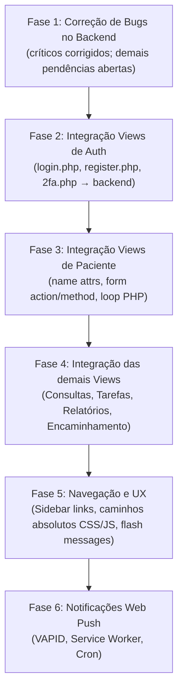

# Análise do Backend — Clínica Marcelo

> [!NOTE]
> Esta análise cobre todos os arquivos PHP do backend: Config, Models, Controllers, Auth, Routes e Views. Atualizado em 14/11/2026 após a correção dos bugs críticos B1–B5, B7, B9, B10 e B14–B19 da seção 4.1 (commit `9ea9e8b`). Os demais itens continuam pendentes.

---

## 1. Visão Geral da Arquitetura

O projeto segue uma estrutura **MVC manual** (sem framework pesado), centralizado na experiência de uso exclusivo do psicólogo:

| Camada | Localização | Responsabilidade | Status |
|---|---|---|---|
| **Config** | `Backend/Config/Database.php` | Singleton PDO para conexão MySQL | ✅ Ativo |
| **Models** | `Backend/Models/*.php` | Queries SQL diretas com PDO Prepared Statements | ✅ Atualizados |
| **Controllers** | `Backend/Controllers/*.php` | Recebe requisições, valida e delega para Models | ✅ Em expansão |
| **Routes** | `Backend/Routes/routes.php` | Mapeamento de rotas com Bramus Router | ✅ Criado |
| **Entry point** | `index.php` | Carrega autoload, models, controllers e executa o router | ✅ Estruturado |
| **Servidor Web** | `.htaccess` | Regras de rewrite para encaminhar URLs amigáveis ao `index.php` | ✅ Criado |
| **Auth** | `Backend/Auth/Auth.php` | Sessões, proteção de rotas e verificação de 2FA em memória | ✅ Concluído |
| **Notificações** | `Backend/Notifications/`, `Backend/Cron/`, `sw.js` | Estrutura para alertas Web Push aos 10 minutos da consulta | ⏳ Estruturado (vazio) |
| **Views** | `Views/**/*.php` / `.html` | Telas do sistema (gerenciadas por outra frente) | ⏳ Visualização e carregamento da edição de paciente conectados; demais integrações pendentes |
| **Layout (Web Components)** | `js/layout.js` | Sidebar, footer e paginação de tabelas via Custom Elements | ✅ Funcional |

---

## 2. Regras de Negócio e Decisões de Projeto

| Regra | Descrição | Status |
|---|---|---|
| **Criação Centralizada de Pacientes** | O cadastro de paciente reúne Paciente, Perfil, Encaminhamento e Agendamento em um único formulário. Paciente é obrigatório; Perfil e Agendamento exigem todos os seus campos; Encaminhamento exige ao menos um. | ✅ Concluído |
| **Atualização em Cascata (Upsert)** | Atualizar o paciente também atualiza ou cria (caso ainda não existam) seus registros de Perfil, Agendamento e Encaminhamento via relação 1-1 baseada no `id_paciente`. | ✅ Concluído |
| **Preservação de Dados (Soft Delete / Status)** | Pacientes nunca são deletados fisicamente do banco de dados; são marcados como inativos e ocultados das listagens até eventual reativação. | ⏳ A implementar |
| **Conta Única do Psicólogo** | Apenas um psicólogo atua na clínica. O registro de conta só é permitido uma única vez. Registros subsequentes são sumariamente bloqueados. | ✅ Concluído |
| **Autenticação em Dois Fatores (2FA)** | O login exige e-mail + senha e, em seguida, validação de código numérico temporário de 6 dígitos gerado e conferido via memória de sessão (`$_SESSION`), disparado por e-mail. | ✅ Concluído |
| **Notificação de Consulta a 10 Minutos** | Disparo de alerta ao psicólogo 10 minutos antes do início de uma consulta via Web Push (PWA / Browser) sem exigir aplicativo nativo. | ⏳ Arquivos criados |

---

## 3. Histórico de Alterações Realizadas

### 3.1 Correções Críticas (Bugs & Segurança)
1. **Lógica de validação `!empty()`**: Corrigido o agrupamento `&&` indevido que estava dentro da função `empty()` em `PacienteController.php` e `TarefaController.php`.
2. **Inversão de parâmetros**: Corrigida a ordem de `telefone` e `data_nascimento` passada de `PacienteController.php` para `Paciente.php`.
3. **SQL Injection eliminado**: Sanitizado o método `atualizarPerfil` em `Perfil.php`, substituindo interpolação direta por bind `:id` / `:id_paciente`.
4. **Typos corrigidos**: Corrigido erro de digitação de coluna `id_agedamento` e strings em `Agendamento.php`.
5. **Geração de consultas**: Corrigida chamada invertida de `$mes/$ano`, formatação de string ISO de datas e declaração estática do método auxiliar em `Consulta.php`.

### 3.2 Cadastro Centralizado e Upserts
- **`Paciente.php`**: `criarPaciente()` ajustado para retornar o `id_paciente` via `lastInsertId()`. Implementado `atualizarPaciente()`.
- **`Perfil.php`**: `atualizarPerfil()` refatorado para operar por `id_paciente` com verificação de existência (upsert).
- **`Encaminhamento.php`**: Implementado `atualizarEncaminhamento()` com verificação de existência (upsert).
- **`Agendamento.php`**: Corrigido nome de variável `$horario_inicio` e implementado `atualizarAgendamento()` com verificação de existência (upsert).
- **`PacienteController.php`**:
  - `criar()`: Valida obrigatoriedade estrita do Paciente; cria condicionalmente Perfil e Agendamento (se todos os campos preenchidos) e Encaminhamento (se ao menos um campo preenchido).
  - `atualizar($id)`: Aplica a mesma regra condicional com upsert nas entidades associadas.

### 3.3 Roteamento e Entry Point
- **`.htaccess`**: Criado com regras de rewrite para Apache, redirecionando requisições ao `index.php`.
- **`index.php`**: Transformado em front controller oficial da aplicação (sessão, autoload, models, controllers e execução do router).
- **`Backend/Routes/routes.php`**: Mapeamento inicial das rotas RESTful para Pacientes, Consultas, Tarefas, Perfil, Relatórios e Auth com Bramus Router.

### 3.4 Autenticação Completa com Conta Única e 2FA
- **`Backend/Models/Psicologo.php`**: Implementado `existePsicologo()` para garantir conta única, `criarPsicologo()` com `password_hash()`, e `fazerLogin()` com `password_verify()`. Corrigida query de listagem.
- **`Backend/Auth/Auth.php`**: Implementado gerenciamento de sessão, geração e conferência de código 2FA em memória (`$_SESSION`), disparo de e-mail/log, middleware de proteção `Auth::verificar()` e `Auth::logout()`.
- **`Backend/Controllers/PsicologoController.php`**: Métodos `formLogin()`, `login()`, `form2fa()`, `verificar2fa()`, `formRegistrar()`, `registrar()`, `logout()` e `perfil()`.
- **`Backend/Routes/routes.php`**: Ativado o middleware `Auth::verificar()` protegendo todas as rotas privadas.

### 3.5 Correção dos Bugs Críticos da Seção 4.1 — 14/11/2026

- **B1–B4**: Corrigida a capitalização de `Config/Database.php` nos quatro includes apontados.
- **B5**: `Consulta::gerarRelatorio()` passou a executar `UPDATE consulta SET relatorio = :relatorio WHERE id_consulta = :id`, mantendo os parâmetros preparados.
- **B7 e B10**: `PacienteController` carrega o paciente individual e suas associações por `id_paciente`; a visualização usa `paciente-show.php` e a rota de edição chama `editar($id)`. Pacientes inexistentes retornam HTTP 404.
- **Views de paciente**: A visualização exibe os dados carregados com escape HTML; a edição recebe os valores existentes e seleciona as opções correspondentes. Associações ausentes são tratadas como vazias.
- **B9 e B14–B19**: Corrigidas as referências às views PHP na criação de paciente e nos fluxos de login, registro, 2FA e perfil.
- **Validação realizada**: Sintaxe dos 11 arquivos PHP alterados, existência e capitalização dos caminhos e 19 testes isolados com SQLite em memória passaram. A execução com MySQL real permanece pendente; o driver PDO MySQL não está carregado no PHP local.
- **Limite desta entrega**: A seção 4.2 não foi implementada. O envio dos formulários, a busca geral de pacientes e as listagens dinâmicas permanecem pendentes; `login.php` e `register.php` continuam vazios. Notificações, inativação e os demais itens da tabela 4.1 também não foram implementados.

---

## 4. Bugs Encontrados e Problemas de Integração — Status Atual

> [!CAUTION]
> Os bugs críticos B1–B5, B7, B9, B10 e B14–B19 foram corrigidos. A tabela mantém a severidade original e distingue as correções concluídas das pendências. Os testes isolados passaram; a integração completa e a validação com MySQL real ainda estão pendentes.

### 4.1 Bugs Críticos no Backend

| # | Arquivo | Problema identificado / correção | Severidade original | Status atual |
|---|---|---|---|---|
| B1 | `Consulta.php` | Corrigido o include para `../Config/Database.php`, respeitando a capitalização da pasta. | 🔴 Crítico | ✅ Corrigido |
| B2 | `PacienteController.php` | Corrigido o include para `../Config/Database.php`. | 🔴 Crítico | ✅ Corrigido |
| B3 | `ConsultaController.php` | Corrigido o include para `../Config/Database.php`. | 🔴 Crítico | ✅ Corrigido |
| B4 | `TarefaController.php` | Corrigido o include para `../Config/Database.php`. | 🔴 Crítico | ✅ Corrigido |
| B5 | `Consulta.php` | `gerarRelatorio()` agora usa `UPDATE consulta SET relatorio = :relatorio WHERE id_consulta = :id`, com parâmetros preparados. | 🔴 Crítico | ✅ Corrigido |
| B6 | `PacienteController.php` L71 | `Agendamento` no controller espera campo `horario_fim` do POST, mas o Model `Agendamento.php` define o parâmetro como `$horario_termino` e a coluna do BD é `horario_termino`. Existe inconsistência na nomenclatura que pode gerar confusão (embora funcione porque o valor do POST é passado posicionalmente). | 🟡 Média | ⏳ Pendente |
| B7 | `PacienteController.php` | `visualizar($id)` carrega o paciente e suas associações e renderiza `paciente-show.php` com dados reais e escape HTML. ID inexistente retorna HTTP 404. | 🔴 Crítico | ✅ Corrigido |
| B8 | `PacienteController.php` L39 | `criar()` ainda retorna a view de detalhe em falha de validação, sem devolver os dados e erros ao formulário de criação. A view já trata a ausência de dados sem avisos, mas o fluxo de validação continua pendente. | 🟡 Média | ⏳ Pendente |
| B9 | `routes.php` | `GET /pacientes/criar` agora carrega `paciente-create.php`. | 🔴 Crítico | ✅ Corrigido |
| B10 | `routes.php` | `GET /pacientes/{id}/editar` chama `PacienteController::editar($id)`, carrega paciente, perfil, agendamento e encaminhamento e preenche os campos. ID inexistente retorna HTTP 404. | 🔴 Crítico | ✅ Corrigido |
| B11 | `routes.php` L112 | Rota `GET /tarefas/criar` aponta para `tarefa-show.php` — esta view não existe na estrutura de Views/Tarefa; existe apenas `tarefa.php`. | 🟡 Média | ⏳ Pendente |
| B12 | `routes.php` L131 | Rota `GET /relatorios` aponta para `relatorio.html`, mas o arquivo real é `relatorio.php`. | 🟡 Média | ⏳ Pendente |
| B13 | `routes.php` L135 | Rota `GET /relatorios/{id}` aponta para `relatorio-show.html`, mas o arquivo real é `relatorio-show.php`. | 🟡 Média | ⏳ Pendente |
| B14 | `PsicologoController.php` | `formLogin()` agora carrega `login.php`. O conteúdo do formulário continua pendente na seção 4.2. | 🔴 Crítico | ✅ Corrigido |
| B15 | `PsicologoController.php` | Os retornos de erro de `login()` agora carregam `login.php`. | 🔴 Crítico | ✅ Corrigido |
| B16 | `PsicologoController.php` | `form2fa()` agora carrega `2fa.php`. | 🔴 Crítico | ✅ Corrigido |
| B17 | `PsicologoController.php` | Os retornos de erro de `verificar2fa()` agora carregam `2fa.php`. | 🔴 Crítico | ✅ Corrigido |
| B18 | `PsicologoController.php` | `formRegistrar()` e `registrar()` agora carregam `register.php`. O conteúdo do formulário continua pendente na seção 4.2. | 🔴 Crítico | ✅ Corrigido |
| B19 | `PsicologoController.php` | `perfil()` agora carrega `perfil-show.php`. | 🔴 Crítico | ✅ Corrigido |
| B20 | `Backend/Auth/2fa.php` | Arquivo vazio, sem função. Se era para conter lógica de 2FA, esta já está em `Auth.php`. | 🟢 Limpeza | ⏳ Limpeza pendente |
| B21 | `Backend/Controllers/NotificacaoController.php` | Arquivo vazio — rota POST de subscription não tem handler. | 🟢 Pendente | ⏳ Pendente |
| B22 | `Backend/Notifications/WebPushService.php` | Arquivo vazio. | 🟢 Pendente | ⏳ Pendente |
| B23 | `Backend/Cron/notificar_consultas.php` | Arquivo vazio. | 🟢 Pendente | ⏳ Pendente |
| B24 | `sw.js` | Arquivo vazio. | 🟢 Pendente | ⏳ Pendente |
| B25 | `index.php` | Não inclui `NotificacaoController.php` via `require_once`. Se futuramente a rota for mapeada, dará fatal error por classe não encontrada. | 🟡 Média | ⏳ Pendente |
| B26 | `Agendamento.html` L3 | Tag `<html>` duplicada (duas aberturas `<html lang="pt-BR">`). | 🟡 Média | ⏳ Pendente |
| B27 | `Paciente.php` L10-13 | `listarTodos()` retorna **todos** os pacientes sem filtrar por status. Se soft delete for implementado, continuará exibindo inativos. | 🟡 Futura | ⏳ Futuro |

### 4.2 Incompatibilidades entre Views (Frontend) e Backend

> [!WARNING]
> O maior bloqueio atual: os nomes dos campos `name=""` nas Views **não coincidem** com os nomes esperados pelos Controllers via `$_POST`. Nenhum formulário irá funcionar sem essa correção.

#### 4.2.1 Formulário de Cadastro de Paciente (`paciente-create.php`)

| Campo da View (`name`) | Campo esperado pelo Controller (`$_POST`) | Status |
|---|---|---|
| `full_name` | `nome` | ❌ Incompatível |
| `birth_date` | `data_nascimento` | ❌ Incompatível |
| `cpf` | `cpf` | ✅ OK |
| `phone` | `telefone` | ❌ Incompatível |
| `week_day` | `dia_semana` | ❌ Incompatível |
| `repeat_interval` | `repeticao` | ❌ Incompatível |
| `start_time` | `horario_inicio` | ❌ Incompatível |
| *(ausente — não existe horário fim)* | `horario_fim` | ❌ Campo ausente na view |
| `start_date` | `data_inicio` | ❌ Incompatível |
| `clinical_condition` | `quadro` | ❌ Incompatível |
| `description` | `descricao` | ❌ Incompatível |
| `referral_type` | `tipo_encaminhamento` | ❌ Incompatível |
| `history` | `historico_paciente` | ❌ Incompatível |

Além disso:
- O `<form>` **não tem** `method="POST"` nem `action="/pacientes/criar"`.
- O JavaScript atual **impede o submit** (`event.preventDefault()`) e mostra uma mensagem de "não disponível".
- Os `<option value>` do agendamento usam inglês (`monday`, `weekly`) mas o backend/Model espera valores numéricos para `dia_semana` (0-6 conforme `date('w')` do PHP) e strings em português para `repeticao` (`Semanal`, `Quinzenal`, `Mensal`).

#### 4.2.2 Formulário de Edição (`paciente-update.php`)

O carregamento inicial por `GET /pacientes/{id}/editar` foi corrigido em B10: os campos exibem o paciente e suas associações, com escape HTML. A integração de envio continua com os mesmos problemas de `paciente-create.php`, além dos itens abaixo:

- Também **não tem** `method="POST"` nem `action="/pacientes/{id}/editar"`.
- O JavaScript também bloqueia o submit.
- O modal de busca de pacientes lê de um JSON embutido vazio (`[]`). O backend não injeta dados nele.

#### 4.2.3 Formulário de 2FA (`2fa.php`)

- `action` aponta para `../Dashboard/dashboard.html` em vez de `/2fa` (rota correta do backend).
- O formulário já possui `method="post"`; falta corrigir o destino do `action`.

#### 4.2.4 Formulários de Login e Registro

- `login.php` e `register.php` estão **vazios** (0 bytes). Sem HTML algum.

#### 4.2.5 Views de Listagem (Todas)

Todas as views de listagem (`paciente.php`, `consulta.php`, `tarefa.php`, `encaminhamento.php`, `perfil.php`, `relatorio.php`) possuem **dados estáticos hardcoded** (nomes fictícios, placeholders "XXXX"). Nenhuma faz loop PHP sobre dados do banco.

#### 4.2.6 Caminhos de CSS/JS nas Views

Todas as views usam caminhos relativos `../../css/` e `../../js/`. Isso funciona apenas se o servidor resolver o caminho relativo ao arquivo `.php`, **não** quando o roteador serve via `index.php` na raiz. Com Apache + `.htaccess`, as requisições a `/pacientes` vão para `index.php` e os caminhos relativos quebram. Devem ser caminhos absolutos: `/css/`, `/js/`.

#### 4.2.7 Links de Navegação na Sidebar

Os links do `layout.js` usam `href="#"` com `data-section` mas **não navegam para nenhuma rota**. Precisam apontar para as rotas reais (`/pacientes`, `/consultas`, `/tarefas`, `/relatorios`, `/perfil`, `/logout`).

---

## 5. Mapa de Arquivos — Status Atual

```
clinica-marcelo-backend/
├── index.php                                    ✅ Front controller funcional
├── .htaccess                                    ✅ Rewrite configurado
├── composer.json                                ✅ bramus/router
├── sw.js                                        ⏳ Vazio
│
├── Backend/
│   ├── Auth/
│   │   ├── Auth.php                             ✅ Completo
│   │   └── 2fa.php                              ⚠️ Vazio (redundante)
│   ├── Config/
│   │   └── Database.php                         ✅ Singleton PDO
│   ├── Controllers/
│   │   ├── PacienteController.php               ⚠️ B7/B10 corrigidos; B6/B8 pendentes
│   │   ├── ConsultaController.php               ✅ B3 corrigido
│   │   ├── TarefaController.php                 ✅ B4 corrigido
│   │   ├── PsicologoController.php              ✅ B14–B19 corrigidos; views de auth pendentes
│   │   └── NotificacaoController.php            ⏳ Vazio
│   ├── Models/
│   │   ├── Paciente.php                         ✅ CRUD completo
│   │   ├── Perfil.php                           ✅ CRUD + upsert
│   │   ├── Encaminhamento.php                   ✅ CRUD + upsert
│   │   ├── Agendamento.php                      ✅ CRUD + upsert
│   │   ├── Consulta.php                         ✅ B1/B5 corrigidos
│   │   ├── Tarefa.php                           ✅ CRUD
│   │   └── Psicologo.php                        ✅ CRUD + conta única
│   ├── Notifications/
│   │   └── WebPushService.php                   ⏳ Vazio
│   ├── Cron/
│   │   └── notificar_consultas.php              ⏳ Vazio
│   └── Routes/
│       └── routes.php                           ⚠️ B9/B10 corrigidos; B11–B13 pendentes
│
├── Views/
│   ├── Auth/
│   │   ├── login.php                            🔴 Vazio
│   │   ├── register.php                         🔴 Vazio
│   │   └── 2fa.php                              ⚠️ Action errado
│   ├── Paciente/
│   │   ├── paciente.php                         ⚠️ Dados hardcoded
│   │   ├── paciente-create.php                  ⚠️ Names incompatíveis
│   │   ├── paciente-show.php                    ✅ Visualização com dados reais
│   │   └── paciente-update.php                  ⚠️ Dados carregados; envio pendente
│   ├── Consulta/
│   │   ├── consulta.php                         ⚠️ Dados hardcoded
│   │   └── consulta-show.php                    ⚠️ Incompleto
│   ├── Tarefa/
│   │   └── tarefa.php                           ⚠️ Dados hardcoded
│   ├── Encaminhamento/
│   │   └── encaminhamento.php                   ⚠️ Dados hardcoded
│   ├── Perfil/
│   │   ├── perfil.php                           ⚠️ Dados hardcoded
│   │   └── perfil-show.php                      ⚠️ Incompleto
│   ├── Psicologo/
│   │   └── psicologo.php                        ⚠️ Incompleto
│   ├── Relatorio/
│   │   ├── relatorio.php                        ⚠️ Dados hardcoded
│   │   └── relatorio-show.php                   ⚠️ Incompleto
│   └── Agendamento/
│       └── agendamento.html                     ⚠️ HTML duplicado
│
├── css/
│   ├── bootstrap.css / bootstrap.min.css        ✅
│   └── style.css                                ✅
└── js/
    ├── bootstrap.js / bootstrap.min.js          ✅
    └── layout.js                                ⚠️ Links não navegam
```

---

## 6. Próximos Passos — Plano de Correção e Integração



---

### Fase 1: Correção de Bugs no Backend

> [!IMPORTANT]
> Os itens críticos desta fase foram corrigidos. A fase continua parcial porque as rotas de tarefas/relatórios e a inclusão do controller de notificações permanecem pendentes.

| Tarefa | Arquivo(s) | Bugs | Status |
|---|---|---|---|
| Corrigir caminhos `config` → `Config` (case-sensitive) | `Consulta.php`, `PacienteController.php`, `ConsultaController.php`, `TarefaController.php` | B1–B4 | ✅ Corrigido |
| Corrigir `gerarRelatorio()`: trocar `INSERT ... WHERE` por `UPDATE` | `Consulta.php` | B5 | ✅ Corrigido |
| Renderizar a visualização individual com dados reais | `PacienteController.php`, `paciente-show.php` | B7 | ✅ Corrigido |
| Corrigir referências às views de criação de paciente, autenticação e perfil | `PsicologoController.php`, `routes.php` | B9, B14–B19 | ✅ Corrigido |
| Carregar os dados na rota `GET /pacientes/{id}/editar` | `routes.php`, `PacienteController.php`, `paciente-update.php` e models associados | B10 | ✅ Corrigido |
| Corrigir as referências às views de tarefas e relatórios | `routes.php` | B11–B13 | ⏳ Pendente |
| Incluir `NotificacaoController.php` no `index.php` | `index.php` | B25 | ⏳ Pendente |

---

### Fase 2: Integração das Views de Autenticação

| Tarefa | Detalhes |
|---|---|
| **Criar conteúdo de `login.php`** | Formulário com `method="POST" action="/login"`, campos `name="email"` e `name="senha"`, exibição de `$erro` se definido. |
| **Criar conteúdo de `register.php`** | Formulário com `method="POST" action="/registrar"`, campos `name="email"`, `name="senha"`, `name="telefone"`, exibição de `$erro`. |
| **Corrigir `2fa.php`** | Mudar `action` de `../Dashboard/dashboard.html` para `/2fa`, manter `method="post"` e `name="codigo"`. |

---

### Fase 3: Integração das Views de Paciente

| Tarefa | Detalhes |
|---|---|
| **Alinhar `name` dos inputs com o backend** | Renomear: `full_name` → `nome`, `birth_date` → `data_nascimento`, `phone` → `telefone`, `week_day` → `dia_semana`, `repeat_interval` → `repeticao`, `start_time` → `horario_inicio`, `start_date` → `data_inicio`, `clinical_condition` → `quadro`, `description` → `descricao`, `referral_type` → `tipo_encaminhamento`, `history` → `historico_paciente`. |
| **Adicionar campo `horario_fim`** | Input `type="time"` com `name="horario_fim"` na seção de agendamento. |
| **Configurar o `<form>`** | `method="POST" action="/pacientes/criar"` no create. `method="POST" action="/pacientes/<?= $paciente['id_paciente'] ?>/editar"` no update. |
| **Remover `preventDefault()`** | Apagar o JavaScript que bloqueia o submit do formulário. |
| **Alinhar `<option value>` com o backend** | `dia_semana`: usar `0`-`6` (conforme `date('w')`). `repeticao`: usar `Semanal`, `Quinzenal`, `Mensal`. |
| **Implementar listagem dinâmica em `paciente.php`** | Usar `foreach ($pacientes as $p)` para gerar as `<tr>` com dados reais. Links de edição e visualização apontando para `/pacientes/{id}/editar` e `/pacientes/{id}`. |
| **Injetar dados JSON em `paciente-update.php`** | O Controller deve popular o `<script id="patients-data">` com `json_encode($pacientes)`. |

---

### Fase 4: Integração das Demais Views

| View | Ação necessária |
|---|---|
| `consulta.php` | Loop PHP sobre `$consultas`, calcular contadores de status, links reais. |
| `tarefa.php` | Loop PHP sobre `$tarefas`, links de edição. |
| `encaminhamento.php` | Loop PHP sobre dados de encaminhamentos, contadores de tipo. |
| `perfil.php` | Loop PHP sobre perfis de pacientes. |
| `relatorio.php` / `relatorio-show.php` | Loop PHP, implementar `RelatorioController`. |
| `agendamento.html` → `.php` | Converter para PHP, loop sobre agendamentos. |

---

### Fase 5: Navegação e UX

| Tarefa | Detalhes |
|---|---|
| **Corrigir links da Sidebar** | Em `layout.js`, mudar `href="#"` para as rotas reais: `home` → `/pacientes`, `patients` → `/pacientes`, `appointments` → `/consultas`, `reports` → `/relatorios`, `tasks` → `/tarefas`, `profile` → `/perfil`, `logout` → `/logout`. |
| **Caminhos absolutos de assets** | Em todas as views, trocar `../../css/` por `/css/` e `../../js/` por `/js/` para funcionar com o router. |
| **Sistema de Flash Messages** | Criar helper `$_SESSION['flash']` nos controllers + renderização com Toastify.js nas views. |

---

### Fase 6: Implementação das Notificações Web Push

| Arquivo | Função no Sistema |
|---|---|
| `sw.js` *(raiz)* | Service Worker que escuta o evento `push` e exibe o alerta nativo no navegador/celular. |
| `Backend/Notifications/WebPushService.php` | Classe PHP responsável por carregar as chaves VAPID e despachar a notificação via biblioteca `minishlink/web-push`. |
| `Backend/Controllers/NotificacaoController.php` | Controller com rota `POST /notificacoes/salvar-subscription` para armazenar a inscrição. |
| `Backend/Cron/notificar_consultas.php` | Script CLI para rodar a cada minuto, buscando consultas agendadas para os próximos 10 minutos. |

**Tarefas a executar nesta etapa**:
1. Instalar `minishlink/web-push` via Composer: `composer require minishlink/web-push`.
2. Gerar o par de chaves VAPID (pública e privada).
3. Preencher a lógica dos arquivos criados.
4. Mapear as rotas de notificação em `routes.php`.
5. Configurar o agendador de tarefas do SO para executar `notificar_consultas.php` periodicamente.
