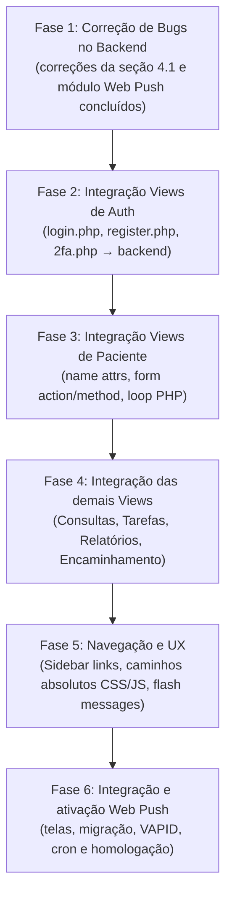

# Análise do Backend — Clínica Marcelo

> [!NOTE]
> Esta análise cobre Config, Models, Controllers, Auth, Routes e Views. Atualizada em 20/11/2026 após a integração das telas de pacientes, consultas, tarefas e dashboard. O módulo Web Push permanece sem ativação no servidor e sem integração dos controles nas telas. Guia: [docs/webpush.md](docs/webpush.md).

---

## 1. Visão Geral da Arquitetura

O projeto segue uma estrutura **MVC manual** (sem framework pesado), centralizado na experiência de uso exclusivo do psicólogo:

| Camada | Localização | Responsabilidade | Status |
|---|---|---|---|
| **Config** | `Backend/Config/Database.php` | Singleton PDO para conexão MySQL | ✅ Ativo |
| **Models** | `Backend/Models/*.php` | Queries SQL diretas com PDO Prepared Statements | ✅ Atualizados |
| **Controllers** | `Backend/Controllers/*.php` | Recebe requisições, valida e delega para Models | ✅ Em expansão |
| **Routes** | `Backend/Routes/routes.php` | Mapeamento de rotas com Bramus Router | ✅ Criado |
| **Entry point** | `index.php` | Carrega autoload, models, controllers e executa o router | ✅ Estruturado |
| **Servidor Web** | `.htaccess` | Regras de rewrite para encaminhar URLs amigáveis ao `index.php` | ✅ Criado |
| **Auth** | `Backend/Auth/Auth.php` | Sessões, proteção de rotas e verificação de 2FA em memória | ✅ Concluído |
| **Notificações** | `Backend/Notifications/`, `Backend/Cron/`, `sw.js` | Módulo reutilizável para lembretes, API, persistência e integração JavaScript | ✅ Implementado; integração visual e ativação pendentes |
| **Views** | `Views/**/*.php` / `.html` | Telas do sistema (gerenciadas por outra frente) | ✅ Cadastro, edição, listagens, relatórios e dashboard conectados; Web Push visual pendente |
| **Layout (Web Components)** | `js/layout.js` | Sidebar, footer e paginação de tabelas via Custom Elements | ✅ Funcional |

---

## 2. Regras de Negócio e Decisões de Projeto

| Regra | Descrição | Status |
|---|---|---|
| **Criação Centralizada de Pacientes** | O cadastro de paciente reúne Paciente, Perfil, Encaminhamento e Agendamento em um único formulário. Paciente é obrigatório; Perfil e Agendamento exigem todos os seus campos; Encaminhamento exige ao menos um. | ✅ Concluído |
| **Atualização em Cascata (Upsert)** | Atualizar o paciente também atualiza ou cria (caso ainda não existam) seus registros de Perfil, Agendamento e Encaminhamento via relação 1-1 baseada no `id_paciente`. | ✅ Concluído |
| **Preservação de Dados (Soft Delete / Status)** | Pacientes nunca são deletados fisicamente do banco de dados; são marcados como inativos e ocultados das listagens até eventual reativação. | ✅ Lista de ativos e alteração de status no formulário de edição |
| **Conta Única do Psicólogo** | Apenas um psicólogo atua na clínica. O registro de conta só é permitido uma única vez. Registros subsequentes são sumariamente bloqueados. | ✅ Concluído |
| **Autenticação em Dois Fatores (2FA)** | O login exige e-mail + senha e, em seguida, validação de código numérico temporário de 6 dígitos gerado e conferido via memória de sessão (`$_SESSION`), disparado por e-mail. | ✅ Concluído |
| **Notificação de Consulta a 10 Minutos** | Nome e horário para todos os dispositivos inscritos, inclusive após logout; recuperar atrasos somente até o início. | ✅ Módulo pronto; desativado por padrão |

---

## 3. Histórico de Alterações Realizadas

### 3.1 Correções Críticas (Bugs & Segurança)
1. **Lógica de validação `!empty()`**: Corrigido o agrupamento `&&` indevido que estava dentro da função `empty()` em `PacienteController.php` e `TarefaController.php`.
2. **Inversão de parâmetros**: Corrigida a ordem de `telefone` e `data_nascimento` passada de `PacienteController.php` para `Paciente.php`.
3. **SQL Injection eliminado**: Sanitizado o método `atualizarPerfil` em `Perfil.php`, substituindo interpolação direta por bind `:id` / `:id_paciente`.
4. **Typos corrigidos**: Corrigido erro de digitação de coluna `id_agedamento` e strings em `Agendamento.php`.
5. **Geração de consultas**: Corrigida chamada invertida de `$mes/$ano`, formatação de string ISO de datas e declaração estática do método auxiliar em `Consulta.php`.

### 3.2 Cadastro Centralizado e Upserts
- **`Paciente.php`**: `criarPaciente()` ajustado para retornar o `id_paciente` via `lastInsertId()`. Implementado `atualizarPaciente()`.
- **`Perfil.php`**: `atualizarPerfil()` refatorado para operar por `id_paciente` com verificação de existência (upsert).
- **`Encaminhamento.php`**: Implementado `atualizarEncaminhamento()` com verificação de existência (upsert).
- **`Agendamento.php`**: Corrigido nome de variável `$horario_inicio` e implementado `atualizarAgendamento()` com verificação de existência (upsert).
- **`PacienteController.php`**:
  - `criar()`: Valida obrigatoriedade estrita do Paciente; cria condicionalmente Perfil e Agendamento (se todos os campos preenchidos) e Encaminhamento (se ao menos um campo preenchido).
  - `atualizar($id)`: Aplica a mesma regra condicional com upsert nas entidades associadas.

### 3.3 Roteamento e Entry Point
- **`.htaccess`**: Criado com regras de rewrite para Apache, redirecionando requisições ao `index.php`.
- **`index.php`**: Transformado em front controller oficial da aplicação (sessão, autoload, models, controllers e execução do router).
- **`Backend/Routes/routes.php`**: Mapeamento inicial das rotas RESTful para Pacientes, Consultas, Tarefas, Perfil, Relatórios e Auth com Bramus Router.

### 3.4 Autenticação Completa com Conta Única e 2FA
- **`Backend/Models/Psicologo.php`**: Implementado `existePsicologo()` para garantir conta única, `criarPsicologo()` com `password_hash()`, e `fazerLogin()` com `password_verify()`. Corrigida query de listagem.
- **`Backend/Auth/Auth.php`**: Implementado gerenciamento de sessão, geração e conferência de código 2FA em memória (`$_SESSION`), disparo de e-mail/log, middleware de proteção `Auth::verificar()` e `Auth::logout()`.
- **`Backend/Controllers/PsicologoController.php`**: Métodos `formLogin()`, `login()`, `form2fa()`, `verificar2fa()`, `formRegistrar()`, `registrar()`, `logout()` e `perfil()`.
- **`Backend/Routes/routes.php`**: Ativado o middleware `Auth::verificar()` protegendo todas as rotas privadas.

### 3.5 Correção dos Bugs Críticos da Seção 4.1 — 14/11/2026

- **B1–B4**: Corrigida a capitalização de `Config/Database.php` nos quatro includes apontados.
- **B5**: `Consulta::gerarRelatorio()` passou a executar `UPDATE consulta SET relatorio = :relatorio WHERE id_consulta = :id`, mantendo os parâmetros preparados.
- **B7 e B10**: `PacienteController` carrega o paciente individual e suas associações por `id_paciente`; a visualização usa `paciente-show.php` e a rota de edição chama `editar($id)`. Pacientes inexistentes retornam HTTP 404.
- **Views de paciente**: A visualização exibe os dados carregados com escape HTML; a edição recebe os valores existentes e seleciona as opções correspondentes. Associações ausentes são tratadas como vazias.
- **B9 e B14–B19**: Corrigidas as referências às views PHP na criação de paciente e nos fluxos de login, registro, 2FA e perfil.
- **Validação realizada**: Sintaxe dos 11 arquivos PHP alterados, existência e capitalização dos caminhos e 19 testes isolados com SQLite em memória passaram. A execução com MySQL real permanece pendente; o driver PDO MySQL não está carregado no PHP local.
- **Limite desta entrega**: A seção 4.2 não foi implementada. O envio dos formulários, a busca geral de pacientes e as listagens dinâmicas permanecem pendentes; `login.php` e `register.php` continuam vazios. Notificações, inativação e os demais itens da tabela 4.1 também não foram implementados.

### 3.6 Correção dos Demais Itens Autorizados da Seção 4.1 — 14/11/2026

- **B6**: Nesta etapa, o controller passou a usar `horario_termino`, com `horario_fim` como alias, preservando domingo (`dia_semana = 0`). O alias foi removido na revisão da seção 3.7.
- **B8**: Cadastros com campos obrigatórios ausentes retornam HTTP 422 ao formulário de criação, com mensagem, valores preservados e escape HTML, sem gravar registros. No sucesso, o controller carrega a visualização do paciente criado.
- **B11**: Criado `Views/Tarefa/tarefa-create.php` com título, conteúdo e data de conclusão. GET e POST `/tarefas/criar` usam o controller; erros retornam HTTP 422 e preservam valores. Sucesso redireciona para `/tarefas` com HTTP 303. A listagem de tarefas ainda usa dados estáticos.
- **B12 e B13**: As rotas de relatórios carregam as views PHP existentes. A integração dos dados de relatórios permanece pendente na seção 4.2.
- **B20**: Excluído apenas o arquivo vazio `Backend/Auth/2fa.php`; a tela `Views/Auth/2fa.php` e a lógica de `Auth.php` foram preservadas.
- **B25**: O entry point inclui `NotificacaoController.php` com buffer local para descartar a quebra de linha do arquivo vazio e não antecipar o envio dos headers. O controller continua sem implementação, conforme a exclusão de B21 do escopo.
- **B26 e B27**: Removida a abertura duplicada de `<html>` em agendamento; `Paciente::listarTodos()` passou a filtrar `status = 'Ativo'`, sem excluir ou alterar registros. A troca de status não foi conectada.
- **Validação realizada**: Sintaxe PHP, caminhos e estrutura HTML verificados. Passaram 28 testes novos e os 19 testes anteriores, com SQLite em memória. Os arquivos de B21–B24 e a tela de 2FA foram conferidos por hash e permaneceram intactos. A validação com MySQL real segue pendente.
- **Limite desta entrega**: Não foram implementados Web Push, inativação/reativação, listagens dinâmicas ou a integração geral dos formulários da seção 4.2.

### 3.7 Alinhamento dos Campos de Paciente — 14/11/2026

- Os formulários de cadastro e edição usam diretamente os nomes do backend nos atributos `name`, incluindo `id_paciente` na edição. Foram removidos os mapas de tradução e os aliases.
- Os dois formulários incluem `horario_termino`. As opções usam dias de 0 a 6, `Semanal`/`Quinzenal`/`Mensal`, `Ativo`/`Inativo` e `Recebimento`/`Envio`.
- O cadastro preserva os valores após erro, escapa a saída com `htmlspecialchars()` e reabre as seções preenchidas. O controller filtra valores não escalares antes de devolver os campos à view.
- A pesquisa em `layout.js` lê `id_paciente`, `nome` e os demais campos diretamente, sem aceitar os nomes antigos.
- **Validação realizada**: Sintaxe PHP/JavaScript, os 47 cenários locais anteriores com expectativas atualizadas, verificação dos campos/opções renderizados, sete dias da semana, seções parciais/vazias, escape HTML e pesquisa/preenchimento em JavaScript. Banco de testes SQLite em memória; sem validação em navegador ou MySQL real.
- **Limite desta entrega**: O envio real continua pendente: os formulários permanecem sem `method`/`action`, com `preventDefault()`, e a edição mantém o botão inicialmente desabilitado. O JSON de pesquisa continua vazio; não foram adicionadas dependências, APIs ou dados fictícios à aplicação.

---

### 3.8 Módulo Web Push — 15/11/2026

- **B21–B24**: Implementados controller JSON autenticado com CSRF, cadastro/desativação de inscrições, remetente com VAPID, seleção de lembretes via CLI e service worker. A API está registrada; as telas não carregam o novo `js/webpush.js` automaticamente.
- Adicionadas migração e reversão manuais para duas tabelas, variáveis de ambiente e gerador CLI de chaves. A conexão PDO aceita opcionalmente lançar erros para o módulo tratar indisponibilidade sem encerrar uma resposta JSON; chamadas existentes preservam seu comportamento.
- Datas interpretadas em São Paulo, consultas `Pendente` de pacientes `Ativo`, recuperação até o início, revalidação antes do envio, histórico por dispositivo/horário, trava MySQL e tratamento de falhas/inscrições expiradas. Mais de uma conta de psicólogo interrompe o agendador até existir vínculo de responsabilidade por consulta.
- A estrutura do MySQL local foi consultada sem alterar registros. A validação usa banco temporário separado, biblioteca real com transporte HTTP simulado e simulação JavaScript do navegador/service worker. Comandos e limites em [docs/webpush.md](docs/webpush.md).
- **Pendente por escopo**: botões e integração nas telas, instalação PWA, aplicação da migração no banco da clínica, chaves do ambiente, agendamento no SO e homologação com dispositivos reais. Nenhuma notificação real foi enviada.

### 3.9 Máscaras, Relatórios e Status de Consultas — 20/11/2026

- O cadastro aplica máscaras de CPF e telefone fixo/celular com JavaScript local, incluindo digitação, colagem, exclusão e preservação do cursor. Os nomes dos campos e o fluxo atual de envio de pacientes foram preservados.
- `GET /consultas` carrega todas as consultas reais, inclusive de pacientes inativos, com data, horário, nome, paginação e contadores. O cartão do mês considera São Paulo; os cartões de realizadas e canceladas consideram toda a lista. Associações ausentes exibem paciente indisponível.
- A coluna Nascimento foi substituída por Relatório. `GET /relatorios/{id}` usa o identificador da consulta e apresenta o texto salvo com escape HTML e quebras de linha preservadas. Relatórios vazios e consultas inexistentes têm respostas próprias. A leitura não cria nem edita relatórios.
- `POST /consultas/{id}/status` recebe `status` e `csrf_token`, exige autenticação e valida o token da sessão. Aceita `Pendente`, `Concluído` e `Cancelado`, incluindo a manutenção do valor atual. O model retorna um booleano; o controller confirma somente depois da gravação e redireciona com HTTP 303. Entradas inválidas, registros inexistentes e falhas do banco não apresentam confirmação de sucesso.
- O MySQL local foi consultado: `consulta.status` é `varchar(45)`, compatível com os três valores. Não foi necessária migração. Falhas de leitura retornam HTTP 503 com mensagem genérica e sem totais inventados; falhas de atualização com leitura disponível retornam HTTP 500.
- **Validação realizada**: 50 verificações HTTP em SQLite isolado, 31 de máscaras/cursor, 11 do model e 29 em tabelas temporárias no MySQL usando cópias da estrutura real. Os registros reais foram preservados. Passaram também as verificações existentes de contrato dos formulários, pesquisa de pacientes e gravação de relatório, além da sintaxe PHP/JavaScript. No navegador foram conferidos máscaras, colagem, exclusão, paginação, lista vazia, troca de status e leitura do relatório, com dados isolados de teste.
- **Pendências preservadas**: envio do cadastro/edição de pacientes, listagem geral de relatórios, criação/edição de relatórios e publicação no servidor. Os artefatos de validação ficam em `.local`, ignorado pelo Git.

### 3.10 Notificações Toast — 20/11/2026

- Integrado Toastify.js 1.12.0 com arquivos locais, catálogo central de 33 frases, fila de sessão PHP e API JavaScript compartilhada. A dependência não utilizada de React Toastify foi substituída.
- Login, 2FA, cadastro da conta, tarefas, consultas e relatórios usam toasts ligados ao resultado real das operações. O formulário de registro aponta para `/registrar`; falhas de validação ou banco não confirmam sucesso. O logout preserva o encerramento da autenticação e usa uma sessão anônima para a confirmação.
- Os avisos fixos permanecem como alternativa sem JavaScript ou biblioteca. Os avisos de cadastro/edição de pacientes indicam indisponibilidade, sem habilitar gravação. Contagens, estados vazios e resultados de pesquisa permanecem como conteúdo.
- Conferidos fila de até três avisos, bloqueio de duplicações, duração por tipo, pausa por foco, fechamento pelo teclado, modais, apresentação no celular e escape HTML. A licença da biblioteca foi preservada separadamente e não foram adicionados comentários ao código.
- Passaram 131 verificações HTTP com SQLite e SMTP simulado, 76 do catálogo/fila PHP, 50 regressões de consultas, os 19 cenários anteriores de autenticação/SMTP e as verificações existentes de máscaras, formulários e pesquisa. Nenhum e-mail real foi enviado e não houve publicação no servidor. Catálogo, integração e validação em [docs/notificacoes-toast.md](docs/notificacoes-toast.md).

### 3.11 Integração do Merge — 20/11/2026

- Combinadas as telas recebidas de Caio com as máscaras, validações, status de consultas e notificações existentes em Lucas.
- Cadastro e edição de pacientes enviam dados reais, com CSRF, validação de datas e seções opcionais completas, transação e confirmação após gravação. A edição preserva associações omitidas e permite inativar o paciente.
- A pesquisa recebe somente id, nome e CPF dos pacientes ativos. Selecionar outro paciente abre seu formulário completo, preservando as associações salvas.
- Relatórios são lidos e editados nas consultas. As rotas antigas de relatório permanecem compatíveis. A edição de tarefas inicializa corretamente o model e valida status e datas antes de salvar.
- Dashboard usa apenas consultas, pacientes e tarefas existentes. A próxima consulta precisa ser futura e pendente, a agenda contém somente o dia atual e o histórico cobre seis meses sem saltos na virada do mês. Ausência de dados produz estados vazios e porcentagens indisponíveis.
- Mantida a rota de perfil com e-mail e telefone reais. Removidas as telas redundantes de encaminhamento, perfil de paciente, relatório e agendamento; seus dados são acessados nas telas de paciente ou consulta.
- Catálogo ampliado para 43 mensagens; removidos os avisos de cadastro e edição indisponíveis. Documentação: [docs/notificacoes-toast.md](docs/notificacoes-toast.md).
- Validação local: 134 verificações HTTP, 50 de regressão de consultas, 96 do helper de toasts, 31 de máscaras, 14 do dashboard, 27 em tabelas temporárias MySQL e 19 cenários de autenticação/SMTP. Cadastro, edição de paciente, tarefas e relatório também foram exercitados pelo navegador. Não houve alteração de registros reais nem publicação no servidor.

### 3.12 Ações e Status Automático de Consultas — 20/11/2026

- Padronizadas as ações da lista com os ícones de lápis e olho, nomes acessíveis e descrições. A visualização permanece disponível mesmo sem relatório.
- O select salva automaticamente pela rota existente, com resposta JSON, CSRF, toast após persistência e atualização dos contadores sem reiniciar a paginação. Falhas restauram a seleção confirmada; o envio convencional permanece como alternativa sem JavaScript.
- A edição do relatório depende do status `Concluído` na lista, nos detalhes, no controller e no comando de atualização do banco. Formulários antigos não podem salvar após a consulta voltar a pendente ou cancelada. O texto existente é preservado.
- Validação: 135 verificações HTTP, 50 de regressão, 12 do cliente, 98 do helper de toasts e 35 em tabelas temporárias MySQL. Os fluxos principais e falhas também foram conferidos pelo navegador. Sem alteração de registros reais ou publicação.

### 3.13 Registro e Configuração do PHP Local — 20/11/2026

- Reproduzido HTTP 503 ao abrir `/registrar`: o servidor em `localhost:8000` usava `C:\php\php.ini` sem PDO MySQL e mbstring. Habilitadas essas extensões, OpenSSL e curl e reiniciado o servidor local. A página real voltou a HTTP 200, sem toast de erro inicial.
- O cadastro agora informa `telefone` vazio explicitamente, pois o formulário não coleta esse campo e a estrutura real o exige sem valor padrão. Isso evita falha também com MySQL em modo estrito, preservando a conta única e a senha com hash.
- Falhas ao consultar o cadastro usam mensagem específica; o log registra somente a etapa e o SQLSTATE. Guia: [docs/configuracao-local.md](docs/configuracao-local.md).
- Validação: 51 verificações HTTP isoladas, 11 em tabela temporária MySQL estrita, 19 cenários de autenticação e 100 do helper de toasts. Página real conferida no navegador. Contas reais preservadas, sem criar a primeira conta nem enviar e-mails.

### 3.14 Geração Manual e Automática de Consultas — 20/11/2026

- Adicionado o botão “Gerar consultas do mês”, ligado à rota existente com autenticação, CSRF e toasts de sucesso, ausência de novas ocorrências ou falha.
- Cadastro e edição com agendamento completo geram automaticamente as consultas do mês atual apenas para o paciente salvo, reutilizando o cálculo de recorrência existente. Sem agendamento informado, a geração não é chamada.
- A geração participa da transação de salvamento do paciente ou abre sua própria transação na ação manual. Agendamentos são bloqueados no MySQL durante a operação; ocorrências existentes são preservadas e os novos registros recebem status `Pendente`.
- Corrigido o envio do CPF ao campo numérico do banco: máscaras são removidas antes de gravar tanto no cadastro quanto na edição. Isso evita truncamento e falha com MySQL estrito, sem modificar registros antigos.
- Validação: 88 verificações HTTP, 21 em tabelas temporárias MySQL estritas, 12 de regressão do cliente e 102 de toasts. Cadastro, edição, geração manual e ausência de duplicação também foram conferidos no navegador, com dados isolados.

## 4. Bugs Encontrados e Problemas de Integração — Status Atual

> [!CAUTION]
> Os itens B1–B27 foram tratados; os registros originais abaixo são históricos. A integração atual é descrita na seção 3.11 e na seção 4.2. B21–B24 têm módulo implementado, sem ativação no servidor ou controles nas telas. As verificações MySQL usam tabelas temporárias, sem alterar registros reais.

### 4.1 Bugs Críticos no Backend

| # | Arquivo | Problema identificado / correção | Severidade original | Status atual |
|---|---|---|---|---|
| B1 | `Consulta.php` | Corrigido o include para `../Config/Database.php`, respeitando a capitalização da pasta. | 🔴 Crítico | ✅ Corrigido |
| B2 | `PacienteController.php` | Corrigido o include para `../Config/Database.php`. | 🔴 Crítico | ✅ Corrigido |
| B3 | `ConsultaController.php` | Corrigido o include para `../Config/Database.php`. | 🔴 Crítico | ✅ Corrigido |
| B4 | `TarefaController.php` | Corrigido o include para `../Config/Database.php`. | 🔴 Crítico | ✅ Corrigido |
| B5 | `Consulta.php` | `gerarRelatorio()` agora usa `UPDATE consulta SET relatorio = :relatorio WHERE id_consulta = :id`, com parâmetros preparados. | 🔴 Crítico | ✅ Corrigido |
| B6 | `PacienteController.php` | Padronizado apenas `horario_termino` na criação, atualização e nos formulários, sem alias `horario_fim`. Domingo (`dia_semana = 0`) é aceito. | 🟡 Média | ✅ Corrigido |
| B7 | `PacienteController.php` | `visualizar($id)` carrega o paciente e suas associações e renderiza `paciente-show.php` com dados reais e escape HTML. ID inexistente retorna HTTP 404. | 🔴 Crítico | ✅ Corrigido |
| B8 | `PacienteController.php` / `paciente-create.php` | Validação retorna HTTP 422 ao formulário de criação, com mensagem e valores preservados com escape HTML, sem gravação. Sucesso carrega a visualização do paciente criado. | 🟡 Média | ✅ Corrigido |
| B9 | `routes.php` | `GET /pacientes/criar` agora carrega `paciente-create.php`. | 🔴 Crítico | ✅ Corrigido |
| B10 | `routes.php` | `GET /pacientes/{id}/editar` chama `PacienteController::editar($id)`, carrega paciente, perfil, agendamento e encaminhamento e preenche os campos. ID inexistente retorna HTTP 404. | 🔴 Crítico | ✅ Corrigido |
| B11 | `routes.php` / `TarefaController.php` | GET e POST `/tarefas/criar` usam a nova view `tarefa-create.php`. O formulário valida dados obrigatórios e data, preserva valores nos erros e redireciona após salvar. | 🟡 Média | ✅ Corrigido |
| B12 | `routes.php` | `GET /relatorios` agora carrega `relatorio.php`. A integração dos dados segue pendente na seção 4.2. | 🟡 Média | ✅ Corrigido |
| B13 | `routes.php` | `GET /relatorios/{id}` usa o identificador da consulta, carrega os dados pelo `ConsultaController` e apresenta o texto salvo em `relatorio-show.php`. | 🟡 Média | ✅ Corrigido |
| B14 | `PsicologoController.php` | `formLogin()` carrega o formulário funcional, com validação e notificações toast. | 🔴 Crítico | ✅ Corrigido |
| B15 | `PsicologoController.php` | Os retornos de erro de `login()` agora carregam `login.php`. | 🔴 Crítico | ✅ Corrigido |
| B16 | `PsicologoController.php` | `form2fa()` agora carrega `2fa.php`. | 🔴 Crítico | ✅ Corrigido |
| B17 | `PsicologoController.php` | Os retornos de erro de `verificar2fa()` agora carregam `2fa.php`. | 🔴 Crítico | ✅ Corrigido |
| B18 | `PsicologoController.php` | `formRegistrar()` e `registrar()` carregam o formulário funcional de conta única, com validação e notificações toast. | 🔴 Crítico | ✅ Corrigido |
| B19 | `PsicologoController.php` | `perfil()` agora carrega `perfil-show.php`. | 🔴 Crítico | ✅ Corrigido |
| B20 | `Backend/Auth/2fa.php` | Arquivo vazio e redundante excluído. A lógica em `Auth.php` e a tela `Views/Auth/2fa.php` foram preservadas. | 🟢 Limpeza | ✅ Removido |
| B21 | `Backend/Controllers/NotificacaoController.php` | API de configuração, cadastro e remoção com sessão/2FA e CSRF. | 🟢 Pendente | ✅ Implementado; integração visual pendente |
| B22 | `Backend/Notifications/WebPushService.php` | Envio criptografado/VAPID, validação de destino e classificação de resultados. | 🟢 Pendente | ✅ Implementado; configuração pendente |
| B23 | `Backend/Cron/notificar_consultas.php` | CLI com janela de dez minutos, recuperação, deduplicação, trava e simulação. | 🟢 Pendente | ✅ Implementado; tarefa do SO pendente |
| B24 | `sw.js` | Exibição da mensagem e abertura de consultas; descarta payloads vencidos. | 🟢 Pendente | ✅ Implementado; registro nas telas pendente |
| B25 | `index.php` | Inclui o controller de notificações sem emitir conteúdo; o buffer do antigo arquivo vazio foi removido. | 🟡 Média | ✅ Corrigido |
| B26 | `Views/Agendamento/agendamento.html` | Removida a segunda abertura de `<html>`, mantendo uma única raiz HTML. | 🟡 Média | ✅ Corrigido |
| B27 | `Paciente.php` | `listarTodos()` filtra `status = 'Ativo'`. Não altera nem exclui registros e não conecta a troca de status ou a listagem visual. | 🟡 Futura | ✅ Corrigido |

### 4.2 Incompatibilidades entre Views (Frontend) e Backend

> [!WARNING]
> Cadastro e edição de paciente, listagens, tarefas, relatórios e navegação estão integrados. As validações do navegador complementam a validação no servidor.

#### 4.2.1 Formulário de Cadastro de Paciente (`paciente-create.php`)

| Campo da View (`name`) | Campo esperado pelo Controller (`$_POST`) | Status |
|---|---|---|
| `nome` | `nome` | ✅ Alinhado |
| `data_nascimento` | `data_nascimento` | ✅ Alinhado |
| `cpf` | `cpf` | ✅ Alinhado |
| `telefone` | `telefone` | ✅ Alinhado |
| `dia_semana` | `dia_semana` | ✅ Alinhado |
| `repeticao` | `repeticao` | ✅ Alinhado |
| `horario_inicio` | `horario_inicio` | ✅ Alinhado |
| `horario_termino` | `horario_termino` | ✅ Alinhado |
| `data_inicio` | `data_inicio` | ✅ Alinhado |
| `quadro` | `quadro` | ✅ Alinhado |
| `descricao` | `descricao` | ✅ Alinhado |
| `tipo_encaminhamento` | `tipo_encaminhamento` | ✅ Alinhado |
| `historico_paciente` | `historico_paciente` | ✅ Alinhado |

O formulário envia `POST /pacientes/criar`, inclui CSRF e preserva os campos com escape quando recebe HTTP 422. CPF e telefone possuem máscaras. Seções opcionais devem ser preenchidas por completo; datas e horários são validados no servidor. Paciente e associações são gravados em uma única transação.

#### 4.2.2 Formulário de Edição (`paciente-update.php`)

O formulário recebe o paciente e suas associações e envia `POST /pacientes/{id}/editar` com CSRF. Nome e demais campos são editáveis. O status aceita `Ativo` ou `Inativo`; pacientes inativos deixam a lista de ativos. O modal recebe somente id, nome e CPF, com escape JSON, e navega para o formulário completo do paciente selecionado. Associações omitidas permanecem salvas.

#### 4.2.3 Formulário de 2FA (`2fa.php`)

- O formulário envia `POST /2fa`, valida o formato de seis dígitos e apresenta notificações de validação, falha ou acesso concluído. O envio por e-mail continua dependendo da configuração SMTP do ambiente.

#### 4.2.4 Formulários de Login e Registro

- Os formulários enviam para `/login` e `/registrar`, com validação, mensagens específicas e alternativa sem JavaScript. O registro preserva a regra de conta única e verifica a confirmação de senha quando enviada.

#### 4.2.5 Views de Listagem (Todas)

`consulta.php`, `paciente.php` e `tarefa.php` usam registros reais, contadores e paginação com estado vazio explícito. Os relatórios estão nos detalhes de consulta. Encaminhamento, perfil clínico e agendamento ficam associados ao paciente.

#### 4.2.6 Caminhos de CSS/JS nas Views

As telas novas e os formulários alterados usam caminhos absolutos `/css/` e `/js/`, compatíveis com as rotas servidas pelo `index.php`.

#### 4.2.7 Links de Navegação na Sidebar

A navegação principal aponta para `/dashboard`, `/pacientes`, `/consultas`, `/tarefas`, `/perfil` e `/logout`. O perfil do psicólogo mantém uma tela própria de leitura.

---

## 5. Mapa de Arquivos — Status Atual

```
clinica-marcelo-backend/
├── index.php                                    ✅ Front controller funcional
├── .htaccess                                    ✅ Rewrite configurado
├── composer.json                                ✅ Router, e-mail, dotenv, Web Push e Guzzle
├── sw.js                                        ✅ Push e clique; integração visual pendente
│
├── Backend/
│   ├── Auth/
│   │   └── Auth.php                             ✅ Lógica de autenticação e 2FA
│   ├── Config/
│   │   └── Database.php                         ✅ Singleton PDO
│   ├── Controllers/
│   │   ├── PacienteController.php               ✅ Cadastro e edição com validação e transação
│   │   ├── ConsultaController.php               ✅ Lista, status e relatório com dados reais
│   │   ├── TarefaController.php                 ✅ Criação e edição com validação e toasts
│   │   ├── PsicologoController.php              ✅ Autenticação e perfil conectados
│   │   ├── DashboardController.php              ✅ Indicadores reais e estados vazios
│   │   └── NotificacaoController.php            ✅ API autenticada com CSRF
│   ├── Models/
│   │   ├── Paciente.php                         ✅ CRUD + filtro de ativos
│   │   ├── Perfil.php                           ✅ CRUD + upsert
│   │   ├── Encaminhamento.php                   ✅ CRUD + upsert
│   │   ├── Agendamento.php                      ✅ CRUD + upsert
│   │   ├── Consulta.php                         ✅ B1/B5 corrigidos
│   │   ├── Tarefa.php                           ✅ CRUD
│   │   └── Psicologo.php                        ✅ CRUD + conta única
│   ├── Notifications/
│   │   ├── WebPushService.php                   ✅ Transporte criptografado/VAPID
│   │   └── demais componentes                  ✅ Configuração, validação, repositório e lembretes
│   ├── Migrations/                              ✅ Instalação/reversão manuais do Web Push
│   ├── Cron/
│   │   └── notificar_consultas.php              ✅ CLI pronto; agendamento pendente
│   └── Routes/
│       └── routes.php                           ✅ Referências às views corrigidas
│
├── Views/
│   ├── Auth/
│   │   ├── login.php                            ✅ Formulário conectado e toasts
│   │   ├── register.php                         ✅ Conta única, validação e toasts
│   │   └── 2fa.php                              ✅ POST correto, validação e toasts
│   ├── Paciente/
│   │   ├── paciente.php                         ✅ Lista de pacientes ativos
│   │   ├── paciente-create.php                  ✅ Cadastro, máscaras e toasts
│   │   ├── paciente-show.php                    ✅ Visualização com dados reais
│   │   └── paciente-update.php                  ✅ Edição, pesquisa e toasts
│   ├── Consulta/
│   │   ├── consulta.php                         ✅ Dados reais, status e relatório
│   │   ├── consulta-show.php                    ✅ Dados reais e relatório
│   │   └── consulta-update.php                  ✅ Edição de relatório
│   ├── Tarefa/
│   │   ├── tarefa.php                           ✅ Lista real com contadores
│   │   ├── tarefa-create.php                    ✅ Formulário conectado ao controller
│   │   └── tarefa-update.php                    ✅ Edição com validação e CSRF
│   ├── Perfil/
│   │   └── perfil-show.php                      ✅ E-mail e telefone do psicólogo
│   ├── Dashboard/
│   │   └── dashboard.php                        ✅ Indicadores e agenda reais
│   └── Shared/
│       ├── toasts.php                           ✅ Mensagens compartilhadas
│       └── error.php                            ✅ Falhas de leitura e gravação
│
├── css/
│   ├── bootstrap.css / bootstrap.min.css        ✅
│   └── style.css                                ✅
└── js/
    ├── bootstrap.js / bootstrap.min.js          ✅
    └── layout.js                                ✅ Navegação, pesquisa e paginação
```

---

## 6. Próximos Passos — Plano de Correção e Integração



---

### Fase 1: Correção de Bugs no Backend

> [!IMPORTANT]
> As correções desta fase e o módulo Web Push foram implementados. A integração das views e a ativação dos lembretes permanecem nas etapas seguintes.

| Tarefa | Arquivo(s) | Bugs | Status |
|---|---|---|---|
| Corrigir caminhos `config` → `Config` (case-sensitive) | `Consulta.php`, `PacienteController.php`, `ConsultaController.php`, `TarefaController.php` | B1–B4 | ✅ Corrigido |
| Corrigir `gerarRelatorio()`: trocar `INSERT ... WHERE` por `UPDATE` | `Consulta.php` | B5 | ✅ Corrigido |
| Renderizar a visualização individual com dados reais | `PacienteController.php`, `paciente-show.php` | B7 | ✅ Corrigido |
| Corrigir referências às views de criação de paciente, autenticação e perfil | `PsicologoController.php`, `routes.php` | B9, B14–B19 | ✅ Corrigido |
| Carregar os dados na rota `GET /pacientes/{id}/editar` | `routes.php`, `PacienteController.php`, `paciente-update.php` e models associados | B10 | ✅ Corrigido |
| Corrigir as referências às views de tarefas e relatórios | `routes.php` | B11–B13 | ✅ Corrigido |
| Incluir `NotificacaoController.php` no `index.php` | `index.php` | B25 | ✅ Corrigido |

---

### Fase 2: Integração das Views de Autenticação

| Tarefa | Detalhes |
|---|---|
| **Criar conteúdo de `login.php`** | ✅ Formulário conectado a `/login`, com validação e toasts. |
| **Criar conteúdo de `register.php`** | ✅ Formulário conectado a `/registrar`, com e-mail, senha, confirmação e toasts. |
| **Corrigir `2fa.php`** | ✅ Formulário conectado a `/2fa`, com validação e toasts. |

---

### Fase 3: Integração das Views de Paciente

| Tarefa | Detalhes |
|---|---|
| **Alinhar `name` dos inputs com o backend** | ✅ Concluído no cadastro, edição e pesquisa JavaScript, sem mapas ou aliases. |
| **Adicionar campo `horario_termino`** | ✅ Concluído nos dois formulários. O controller aceita somente esse nome. |
| **Configurar o `<form>`** | ✅ Concluído: `method="POST" action="/pacientes/criar"` no create. `method="POST" action="/pacientes/<?= $paciente['id_paciente'] ?>/editar"` no update. |
| **Remover `preventDefault()`** | ✅ Concluído: formulários enviam ao servidor. |
| **Alinhar `<option value>` com o backend** | ✅ Concluído: dias de 0 a 6, repetição em português, status `Ativo`/`Inativo` e encaminhamento `Recebimento`/`Envio`. |
| **Implementar listagem dinâmica em `paciente.php`** | ✅ Concluído: pacientes ativos e links reais. |
| **Injetar dados JSON em `paciente-update.php`** | ✅ Concluído: id, nome e CPF, com escape seguro. |

---

### Fase 4: Integração das Demais Views

| View | Ação necessária |
|---|---|
| `consulta.php` | ✅ Integrada: dados reais, contadores, paginação, alteração de status e relatório. |
| `tarefa.php` | ✅ Lista real e edição funcional. |
| Encaminhamento | ✅ Dados na visualização e edição de paciente; tela redundante removida. |
| Perfil clínico | ✅ Dados na visualização e edição de paciente; tela redundante removida. |
| Relatórios | ✅ Acesso e edição em consultas; rotas antigas compatíveis. |
| `consulta-show.php` / `consulta-update.php` | ✅ Leitura e edição do relatório salvo. |
| Agendamento | ✅ Dados no formulário de paciente; tela estática removida. |

---

### Fase 5: Navegação e UX

| Tarefa | Detalhes |
|---|---|
| **Corrigir links da Sidebar** | ✅ Concluído: dashboard, pacientes, consultas, tarefas, perfil e logout. |
| **Caminhos absolutos de assets** | ✅ Aplicados nas telas novas e nos formulários alterados. |
| **Sistema de Flash Messages** | ✅ Helper de sessão e Toastify local integrados. |

---

### Fase 6: Integração e Ativação das Notificações Web Push

| Arquivo | Função no Sistema |
|---|---|
| `sw.js` *(raiz)* | Implementado: recebe push, valida vencimento e abre `/consultas`. |
| `Backend/Notifications/WebPushService.php` | Implementado: envio com VAPID e tratamento de resultados. |
| `Backend/Controllers/NotificacaoController.php` | Implementado: três rotas JSON registradas, com autenticação e CSRF. |
| `Backend/Cron/notificar_consultas.php` | Implementado: executar a cada minuto após configurar o servidor. |

**Tarefas a executar nesta etapa**:
1. Seguir [docs/webpush.md](docs/webpush.md) para instalar dependências no PHP do servidor e aplicar a migração manual no banco correto.
2. Gerar as chaves VAPID e configurar o `.env`; habilitar apenas após preparar o ambiente.
3. Conectar os controles de ativação/desativação nas telas autenticadas usando `js/webpush.js`; preparar instalação PWA quando necessária.
4. Homologar com dados fictícios e dispositivos reais, incluindo permissão negada, logout e múltiplos dispositivos.
5. Configurar o agendador do SO a cada minuto e acompanhar suas contagens de resultado.
